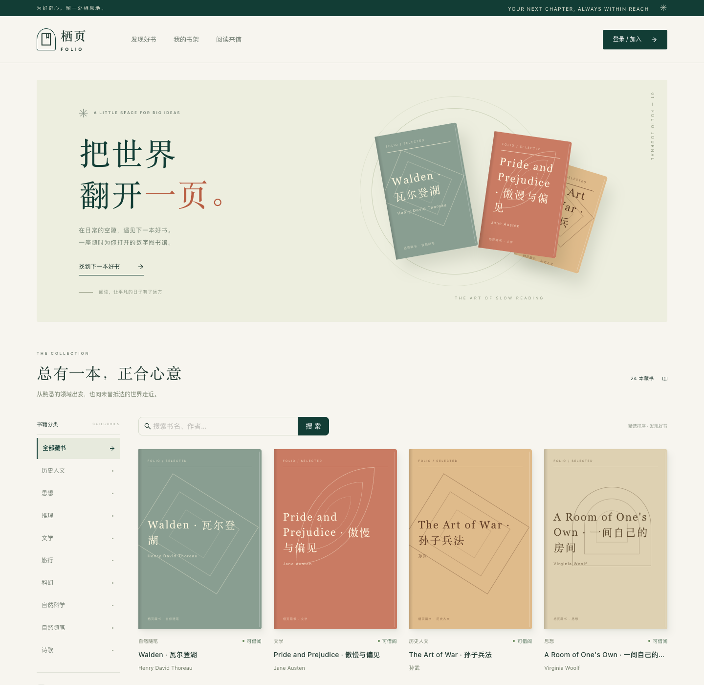

# E-Library Service

English | [简体中文](README.zh-CN.md)

A self-hosted digital library with a book-focused reader experience and an administration console. Independently built React and Java applications run in a small three-service production topology.

**Status:** catalog, lending, account and administration features are implemented, including Chinese/English interfaces. [CI run 44436983590](https://github.com/G-GortoN/e-library-service/actions/runs/44436983590) passed backend tests, frontend checks and a real container smoke test for the bilingual application source. Deployment acceptance and remaining verification limits are documented in [deployment validation](docs/nas-validation.md).

## Demo access

Request the current deployment URL and a reader account privately from the deployment operator. Administrator access and deployment configuration are managed separately.

The reader interface and administration workspace support Chinese/English switching from the globe button, with browser-local preference persistence. Book content retains its original language. Registration and recovery require a configured and verified mail service.

## Scope

| Area | Included |
| --- | --- |
| Catalog | Browse, details, keyword/category/availability filters, pagination and rule-based recommendations |
| Lending | Borrow, idempotent return, active loans, history, renewal and FIFO reservations |
| Identity | Registration, email verification, session login, profile, password change and recovery |
| Administration | Book editing, cover upload, CSV preview/import, publication state, users/roles, loans, reservations and audit |
| Notifications | In-app messages and retryable SMTP delivery for account and lending events |
| Demonstration billing | Overdue calculation, audited waiver and demonstration settlement; no real payment processing |
| Delivery | PostgreSQL migrations, integration tests, bilingual documentation, CI, GHCR images and container runbooks |

F01–F17 and F19–F20 in the [implementation plan](docs/implementation-plan.md) are included. F18 (online PDF/EPUB reader and a separate periodical model) is excluded. Uploads cover images and catalog CSV rather than full book-file distribution.

## Architecture

```text
HTTPS reverse proxy / optional Funnel
                |
     Caddy + React static assets
                | /api
         Spring Boot API
                |
           PostgreSQL
```

- Frontend: React 19, TypeScript, Vite 8, React Router, TanStack Query and Ant Design 6.
- Backend: Java 21, Spring Boot 4, Spring MVC/Security, JPA/JDBC, Flyway and OpenAPI.
- Database: PostgreSQL 17. Notification state and scheduled work share the database; no Redis or message broker is required.
- Runtime: Docker Compose with `web`, `api` and `db`; media, database and certificate data persist independently of images. Node.js is a build dependency.

The reader application uses warm off-white, deep green and restrained terracotta with book-cover grids. The administration console shares the theme with tables, status labels and editing drawers.

## Local development

Requirements: Java 21, Node.js 24 LTS (or a compatible newer version) and PostgreSQL 17. The optional local stack supplies PostgreSQL and Mailpit:

```sh
docker compose -f deploy/compose.local.yml up -d --wait
```

Run the API in another terminal. Replace each bracketed value locally; the database credentials must match the local Compose configuration. Supply a unique administrator password and keep local environment files outside version control.

```sh
cd backend
SPRING_PROFILES_ACTIVE=local \
DATABASE_URL=jdbc:postgresql://localhost:5433/elibrary \
DATABASE_USERNAME=elibrary DATABASE_PASSWORD='<local-database-password>' \
APP_ADMIN_EMAIL='<admin-email>' APP_ADMIN_PASSWORD='<unique-admin-password>' \
./mvnw spring-boot:run
```

Run the frontend:

```sh
cd frontend
npm ci
npm run dev
```

Open `http://localhost:5173`; local test mail is available at `http://localhost:8025`. The `local` profile provides synthetic catalog and reader fixtures. Production has no default administrator password and does not enable demo seeding by default. Obtain access details through the local operator rather than publishing account credentials.

## Verification

| Check | Recorded result |
| --- | --- |
| Backend | CI: 16 passing tests, comprising 15 HTTP/PostgreSQL integration tests and one rate-limit unit test; no failures, errors or skips |
| Frontend | Seven tests, TypeScript checking and production build passed |
| Local bilingual browser | Reader and seven administration routes, language persistence, validation switching, 320–1440 px catalog layouts and authenticated borrowing/return passed |
| Local account and email flows | Captured-mail registration/verification, password recovery and old-session revocation passed |
| Container runtime | Three healthy services; non-root application processes, read-only application filesystems, persistent-volume writes, SPA/deep links and proxied lending lifecycle passed |
| Deployment | HTTPS/session/permission checks, container-recreation persistence and isolated database restoration passed |
| Public HTTPS fallback | Independent health/TLS checks and browser catalog/login/lending checks passed; bilingual update also passed anonymous browser checks |
| IPv6 primary | External reachability acceptance remains pending |
| Production email | SMTP-client self-test delivery and operator receipt confirmed; application JavaMail registration/recovery/lending-mail end-to-end acceptance remains pending |
| Media restoration | Archive readability and retention passed; complete media restoration has not been verified |

Run backend verification against PostgreSQL:

```sh
cd backend
./mvnw verify
```

Integration tests use Testcontainers when Docker is available, or the external database configuration in the [backend guide](backend/README.md). Concurrency verification requires PostgreSQL.

```sh
cd frontend
npm ci
npm test
npm run typecheck
npm run build
```

For a running API, use `python3 deploy/scripts/smoke.py --base-url http://localhost:8080`. The optional authenticated lifecycle check creates and archives a verification book; configure test accounts and mail routing before running it, as described in the [runbook](docs/runbook.md). Build success, public reachability and actual application email delivery are separate checks.

## Deployment and operations

Follow the [runbook](docs/runbook.md) to configure Docker Compose, a public base URL, HTTPS, mail and persistence. Examples use reserved placeholder domains; keep actual hostnames, account details, tokens and private operational evidence outside the public repository.

The deployment supports an IPv6 HTTPS entry and an optional Tailscale Funnel fallback. Its loopback origin, configurable HTTPS port and external certificate support accommodate hosts whose standard ports already serve other applications. Each hostname uses host-only session cookies. Configure DDNS and certificate renewal for the chosen environment; successful local IPv6 access does not prove Internet reachability.

The [release record](docs/release-record.md) separates published source artifacts from validated image references. Both application packages support anonymous manifest access. CI uses disposable fixtures and an HTTP-only test cookie override; production secure-cookie defaults are retained.

## Documentation

| Guide | English | 简体中文 |
| --- | --- | --- |
| Implementation | [Plan](docs/implementation-plan.md) | [实施计划](docs/implementation-plan.zh-CN.md) |
| Backend | [Backend](backend/README.md) | [后端](backend/README.zh-CN.md) |
| Frontend | [Frontend](frontend/README.md) | [前端](frontend/README.zh-CN.md) |
| API contract and usage | [API guide](docs/api-guide.md) | [API 使用指南](docs/api-guide.zh-CN.md) |
| Operations | [Runbook](docs/runbook.md) | [运维手册](docs/runbook.zh-CN.md) |
| Release evidence and image digests | [Release record](docs/release-record.md) | [发布记录](docs/release-record.zh-CN.md) |
| Deployment acceptance and limits | [Deployment validation](docs/nas-validation.md) | [部署验证](docs/nas-validation.zh-CN.md) |
| Production email | [SMTP setup](docs/production-mail.md) | [生产邮件配置](docs/production-mail.zh-CN.md) |

Default `.md` documents are English; `.zh-CN.md` counterparts provide the complete Chinese version. Scope, commands, configuration, API guidance and acceptance changes must be reflected in both languages.

## Design decisions

One concurrent digital license per book keeps allocation explicit. The default loan term is 14 days, a reader can hold five loans, one seven-day renewal is allowed, and a READY reservation has a 48-hour collection window. These values are configurable demonstration assumptions. Publication state is distinct from license availability. Unpublishing and disabling accounts preserve historical records.

Passwords and one-use account tokens are hashed. Session authentication retains CSRF protection and server-side role checks. Credentials, uploaded files, runtime data and personal infrastructure details stay outside source control. SMTP must be configured and verified for real account email flows.

### Local preview

Screenshots from the running local application with example catalog data:

| [Desktop · 1440 px](docs/screenshots/catalog-desktop.png) | [Mobile · 390 px](docs/screenshots/catalog-mobile.png) |
| --- | --- |
|  |  |
