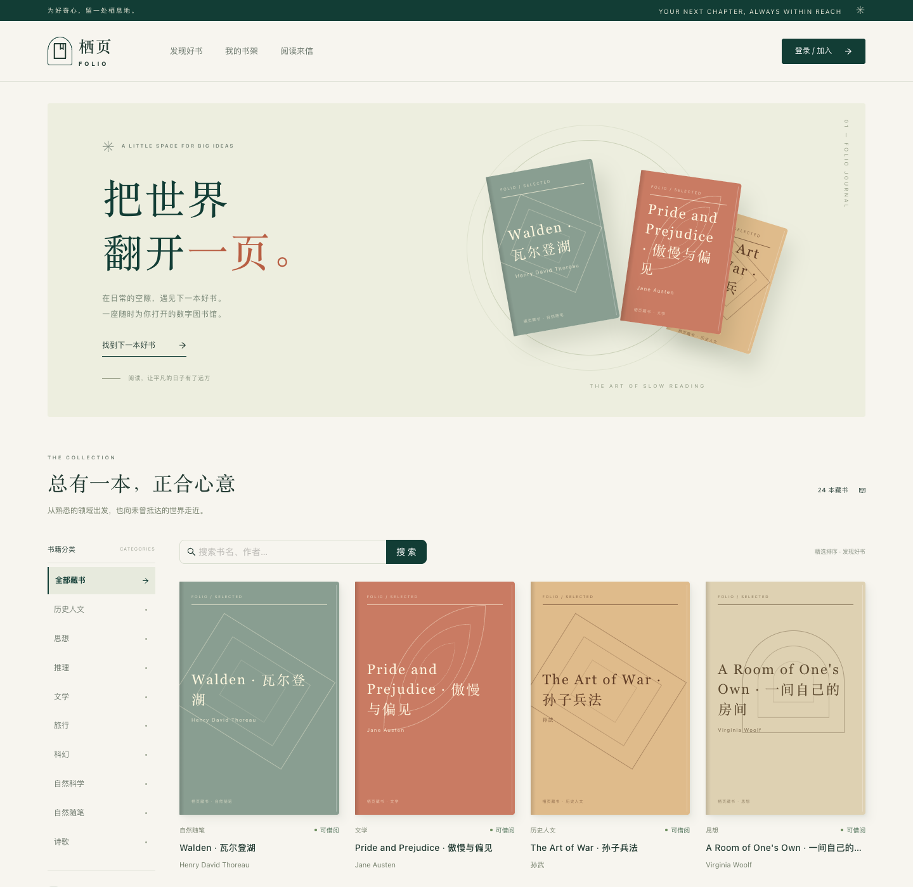
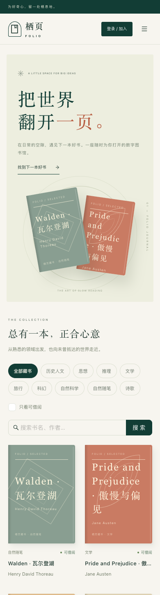

# E-Library Service · 栖页

[English](README.md) | 简体中文

一个可自行部署的数字图书馆，包含以书籍为中心的读者界面和管理后台。React 前端与 Java API 独立构建，生产运行仅需三个服务。

**当前状态：** 图书目录、借阅、账号和后台功能已实现，页面支持中英切换。双语应用源码的 [CI 44436983590](https://github.com/G-GortoN/e-library-service/actions/runs/44436983590) 已通过后端测试、前端检查及真实容器冒烟测试。部署验收范围及尚未完成的验证见[部署验证](docs/nas-validation.zh-CN.md)。

## 演示访问

请向部署维护者私下获取当前访问地址及读者账号。管理员权限和部署配置分别管理。

读者界面和后台均可通过地球按钮切换中文、英文，语言偏好保存在当前浏览器。书籍内容保留原始语言。注册验证和密码找回需要已配置并验证的邮件服务。

## 功能范围

| 领域 | 已包含 |
| --- | --- |
| 图书目录 | 浏览、详情、关键词/分类/可借状态筛选、分页及规则推荐 |
| 借阅 | 借书、幂等归还、当前借阅、历史、续借及 FIFO 预约 |
| 账号 | 注册、邮件验证、会话登录、资料、修改密码及找回密码 |
| 管理后台 | 图书编辑、封面上传、CSV 预览/导入、上下架、用户/角色、借阅、预约及审计 |
| 通知 | 站内消息及支持重试的账号、借阅 SMTP 邮件 |
| 演示账务 | 逾期计算、审计减免及演示结清；不处理真实支付 |
| 交付 | PostgreSQL 迁移、集成测试、双语文档、CI、GHCR 镜像及容器运维手册 |

[实施计划](docs/implementation-plan.zh-CN.md)中的 F01–F17、F19–F20 已纳入交付。F18（在线 PDF/EPUB 阅读器及独立期刊模型）不在范围内。上传功能用于封面图片及目录 CSV，不分发完整图书文件。

## 架构

```text
HTTPS 反向代理 / 可选 Funnel
              |
    Caddy + React 静态资源
              | /api
       Spring Boot API
              |
         PostgreSQL
```

- 前端：React 19、TypeScript、Vite 8、React Router、TanStack Query、Ant Design 6。
- 后端：Java 21、Spring Boot 4、Spring MVC/Security、JPA/JDBC、Flyway、OpenAPI。
- 数据库：PostgreSQL 17。通知状态与定时任务共享数据库，无需 Redis 或消息中间件。
- 运行环境：Docker Compose 的 `web`、`api`、`db` 三服务；媒体、数据库及证书数据独立持久化。Node.js 仅用于构建。

读者页面采用暖白、深绿和少量陶土色，搭配图书封面网格；后台沿用相同主题，以表格、状态标签及编辑抽屉组织操作。

## 本地开发

需要 Java 21、Node.js 24 LTS（或兼容的新版本）及 PostgreSQL 17。可选本地服务提供 PostgreSQL 和 Mailpit：

```sh
docker compose -f deploy/compose.local.yml up -d --wait
```

在另一终端启动 API。请在本机替换尖括号占位值，数据库凭据需与本地 Compose 配置一致。管理员使用独立密码，本地环境文件不得提交到版本库。

```sh
cd backend
SPRING_PROFILES_ACTIVE=local \
DATABASE_URL=jdbc:postgresql://localhost:5433/elibrary \
DATABASE_USERNAME=elibrary DATABASE_PASSWORD='<local-database-password>' \
APP_ADMIN_EMAIL='<admin-email>' APP_ADMIN_PASSWORD='<unique-admin-password>' \
./mvnw spring-boot:run
```

启动前端：

```sh
cd frontend
npm ci
npm run dev
```

访问 `http://localhost:5173`；本地测试邮件可在 `http://localhost:8025` 查看。`local` 配置会创建用于开发的合成目录和读者数据。生产环境没有默认管理员密码，且默认不开启演示数据。访问凭据由本地维护者提供，不在公开文档发布。

## 验证

| 检查 | 已记录结果 |
| --- | --- |
| 后端 | CI 共 16 项通过：15 项 HTTP/PostgreSQL 集成测试及 1 项限流单元测试；无失败、错误或跳过 |
| 前端 | 7 项测试、TypeScript 检查及生产构建通过 |
| 本地双语浏览器 | 读者及 7 个后台路由、语言持久化、验证文案切换、320–1440 px 目录布局、登录后借还通过 |
| 本地账号及邮件流程 | 捕获邮件完成注册/验证、密码找回及旧会话撤销 |
| 容器运行 | 三服务健康；非 root 应用进程、只读应用文件系统、持久卷写入、SPA/深链接及代理借还生命周期通过 |
| 部署环境 | HTTPS/会话/权限、容器重建后数据持久化、独立数据库恢复通过 |
| 公网 HTTPS 备用入口 | 独立健康/TLS 探测及浏览器目录/登录/借还通过；双语更新另通过匿名浏览器验证 |
| IPv6 主入口 | 外网可达性尚待验收 |
| 生产邮件 | SMTP 客户端自检投递和人工收件确认通过；应用 JavaMail 注册/找回/借阅邮件端到端验收尚未完成 |
| 媒体恢复 | 归档可读和文件保留通过；未验证完整媒体恢复 |

使用 PostgreSQL 执行后端验证：

```sh
cd backend
./mvnw verify
```

有 Docker 时集成测试使用 Testcontainers，也可按[后端指南](backend/README.zh-CN.md)配置外部数据库。并发验证需使用 PostgreSQL。

```sh
cd frontend
npm ci
npm test
npm run typecheck
npm run build
```

运行中的 API 可用 `python3 deploy/scripts/smoke.py --base-url http://localhost:8080` 检查。可选的登录生命周期检查会创建并归档一本验收图书；执行前需按[运维手册](docs/runbook.zh-CN.md)配置测试账号与邮件路由。构建成功、公网可达及应用实际邮件投递分别验收。

## 部署与运维

按[运维手册](docs/runbook.zh-CN.md)配置 Docker Compose、公开基础 URL、HTTPS、邮件及持久化。示例使用保留的占位域名；真实主机名、账号、令牌及私有运维证据不存入公开仓库。

部署支持 IPv6 HTTPS 主入口及可选的 Tailscale Funnel 备用入口。回环源站、可配置 HTTPS 端口及外部证书适用于标准端口已被其他应用占用的主机。每个主机名使用独立的 host-only 会话 Cookie。DDNS 与证书续期应按部署环境配置；本地 IPv6 可达不代表公网可达。

[发布记录](docs/release-record.zh-CN.md)区分已发布源码产物和已验证镜像引用。两类应用镜像均可匿名读取 manifest。CI 使用临时测试数据及仅用于 HTTP 测试的 Cookie 覆盖值；生产环境保留安全 Cookie 默认值。

## 文档

| 指南 | English | 简体中文 |
| --- | --- | --- |
| 实施 | [Plan](docs/implementation-plan.md) | [实施计划](docs/implementation-plan.zh-CN.md) |
| 后端 | [Backend](backend/README.md) | [后端](backend/README.zh-CN.md) |
| 前端 | [Frontend](frontend/README.md) | [前端](frontend/README.zh-CN.md) |
| API 契约与使用 | [API guide](docs/api-guide.md) | [API 使用指南](docs/api-guide.zh-CN.md) |
| 运维 | [Runbook](docs/runbook.md) | [运维手册](docs/runbook.zh-CN.md) |
| 发布证据及镜像摘要 | [Release record](docs/release-record.md) | [发布记录](docs/release-record.zh-CN.md) |
| 部署验收及限制 | [Deployment validation](docs/nas-validation.md) | [部署验证](docs/nas-validation.zh-CN.md) |
| 生产邮件 | [SMTP setup](docs/production-mail.md) | [生产邮件配置](docs/production-mail.zh-CN.md) |

默认 `.md` 文档为英文，`.zh-CN.md` 为完整中文版。需求范围、命令、配置、API 指南及验收变化应同步维护两种语言。

## 设计约定

每本书只有一个并发数字许可，明确资源分配。默认借期为 14 天，读者最多同时借 5 本，可续借 1 次、延长 7 天；READY 预约保留 48 小时。这些均为可配置的演示约定。上下架状态与许可可用性分离，下架和停用账号保留历史记录。

密码及一次性账号令牌采用哈希存储。会话认证保留 CSRF 防护及服务端角色校验。凭据、上传文件、运行数据及个人基础设施信息不进入版本库。真实账号邮件流程必须配置并验证 SMTP。

### 本地预览

以下截图来自运行中的本地应用，使用示例图书目录：

| [桌面 · 1440 px](docs/screenshots/catalog-desktop.png) | [移动 · 390 px](docs/screenshots/catalog-mobile.png) |
| --- | --- |
|  |  |
